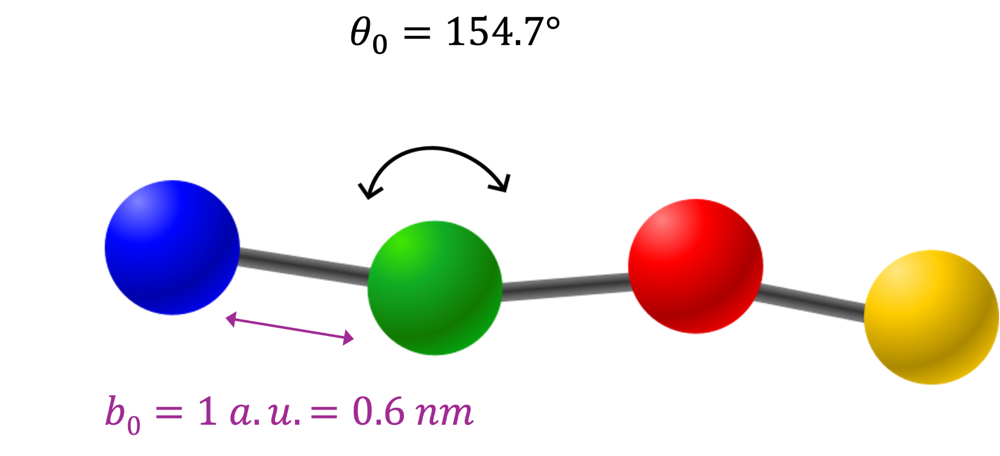
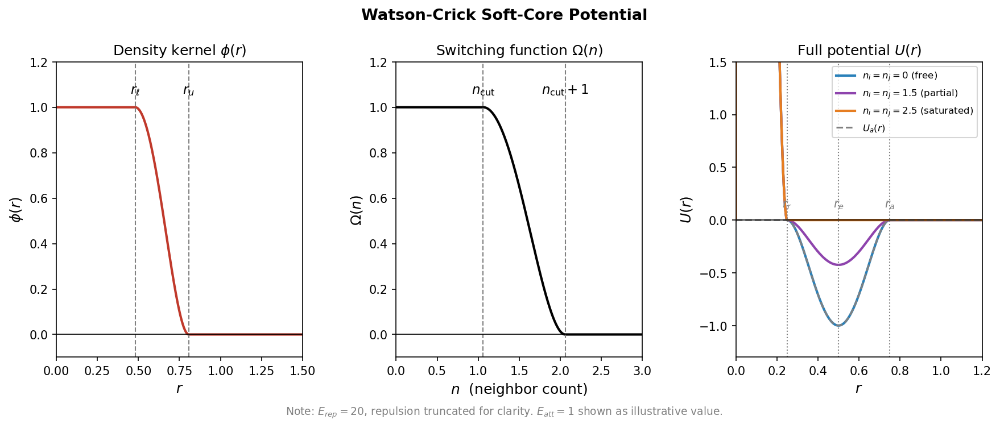
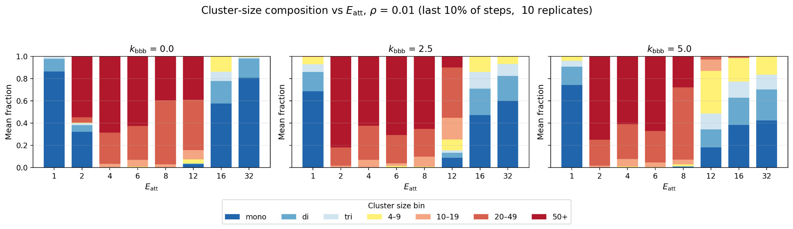
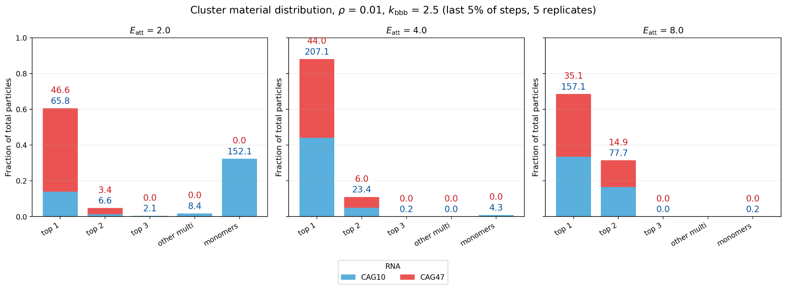

# Coarse-Grained RNA Sticker–Spacer Model

**GPU-accelerated molecular dynamics and reproducible analysis of repeat-RNA clustering.**

This research code implements a one-bead-per-nucleotide RNA model in [HOOMD-blue](https://github.com/glotzerlab/hoomd-blue), with sequence-specific, valency-limited Watson–Crick interactions. It also provides a Python analysis pipeline for transforming simulation trajectories into base-pair contacts, molecular networks, cluster statistics, and publication-ready figures.

The project was developed to investigate how interaction strength, backbone stiffness, repeat length, and RNA composition affect self-assembly. This repository exposes both the **simulation implementation** and the **analysis workflow**; it is not intended as a substitute for the full scientific thesis.

[Simulation source](bulk/) · [Analysis guide](analysis/README.md) · [Scientific metrics](analysis/docs/metrics.md) · [Figure registry](analysis/docs/figures.md) · [Tests](analysis/tests/)



*Each nucleotide is represented by a single connected bead. The equilibrium bond length is one reduced simulation unit (approximately 0.6 nm in the model's physical mapping).*

## Model and interactions

RNA is represented as a flexible bead–spring polymer, with one particle of type **A, U, G, or C** per nucleotide. Consecutive beads are connected by harmonic bonds; harmonic angle potentials control backbone stiffness. Nonbonded forces combine excluded-volume repulsion with complementary attractions (A–U and G–C). Simulations use periodic boundaries and a GPU-backed HOOMD-blue integrator.

Ordinary isotropic attractive potentials can allow a nucleotide to bind several partners at once. To model effectively one-to-one Watson–Crick contacts without explicit orientational patches, the simulation uses a **density-dependent, valency-bounding interaction**: a smooth local-neighbor count suppresses attraction as the available binding valency becomes saturated.

This approach is described in **Dmitriev, Gupta & Goloborodko (2026), [*Valency-bounding correction potential for coarse-grained molecular dynamics simulations*](https://arxiv.org/abs/2609.07842)**. The paper introduces the valency-bounding correction (VBC) as a many-body modification of soft-core attractions, and reports an open-source HOOMD-blue GPU implementation. The model here imports the SQD interface `hoomd.sqd_plugin.sqd_potential`; the exact plugin checkout/build must be compatible with that API. See [dependencies](#installation-and-source-builds) below.



*Illustration of the smoothed neighbor-density kernel, valency switching, and the resulting suppressed attractive well. The plotted parameter values are illustrative, not a complete specification of each production run.*

The simulation exposes the physical and numerical parameters in [`bulk/params.py`](bulk/params.py), including attraction strength `E_att`, backbone stiffness `angle_k_ppp`, particle density, and two valency/switching parameter presets (`V1` and `V2`). The force construction and GPU setup are in [`bulk/setup.py`](bulk/setup.py) and [`bulk/simulation.py`](bulk/simulation.py).

## From molecular dynamics to quantitative analysis

The repository separates the GPU simulation from the CPU-compatible scientific analysis:

```text
RNA sequence definitions + parameter settings
                      │
                      ▼
       HOOMD-blue GPU simulation
                      │
                      ▼
           GSD trajectories
                      │
                      ▼
      Complementary particle contacts
                      │
                      ▼
     Weighted RNA–RNA contact graphs
                      │
                      ▼
 Cluster statistics + per-replicate metrics
                      │
                      ▼
      SQLite checkpoints + CSV tables
                      │
                      ▼
    Jupyter figures and visualizations
```

The maintained pipeline, [`analysis/run_pipeline.py`](analysis/run_pipeline.py), applies complementary-base, geometric, chain-neighbor, and mutual-partner filters; builds molecular contact graphs; computes framewise observables; and exports plotting-ready replicate and condition tables. Scientific computations live in [`analysis/src/`](analysis/src/), while [`analysis/notebooks/`](analysis/notebooks/) contains thin figure-generating notebooks.

Outputs include pair counts (intra- and intermolecular), qualifying graph edges, connected components, particle-weighted cluster-size distributions, ranked clusters, contact recurrence, and species-resolved mixture measurements. Definitions and denominators are documented in the [metric reference](analysis/docs/metrics.md).

## Example applications

The following plots illustrate two applications of the simulation and analysis framework, rather than attempting to reproduce every result in the thesis.

### Reentrant clustering of repeat RNA



*Example CAG47 sweep at reduced density 0.01: cluster-size composition changes non-monotonically with attraction strength. The figure summarizes the final 10% of sampled steps over 10 replicates. See [reentrance notebook](analysis/notebooks/02_reentrance.ipynb).*

### Assembly in mixtures of different RNA lengths



*Example mixed-RNA system: contributions from short CAG10 (blue) and long CAG47 (red) chains across ranked cluster classes. This is a thesis-era figure using the **final 5%** of steps; the current pipeline defaults to the **final 10%** of sampled frames. See [mixture notebook](analysis/notebooks/04_mixtures.ipynb).*

Further analyses cover repeat-length dependence, scrambled sequence controls, two-dimensional projections, and optional interactive PyVis molecular networks. See the [length notebook](analysis/notebooks/03_length.ipynb) and [figure registry](analysis/docs/figures.md).

## Installation and source builds

The Python analysis tools and the GPU simulation have different dependency requirements.

**For analysis and the test suite**, use the repository's dependency specifications:

```bash
conda env create -f environment.yml
conda activate validation_env

python -m pytest analysis/tests -q
```

For a smaller CPU-only setup, see [`analysis/requirements.txt`](analysis/requirements.txt), [`analysis/requirements-test.txt`](analysis/requirements-test.txt), and [`analysis/requirements-trajectory.txt`](analysis/requirements-trajectory.txt). GSD/freud are needed to reprocess trajectories, but HOOMD-blue is not needed to analyze saved NPZs or run the basic tests.

**For new GPU simulations**, two additional components must be **compiled from source** against a compatible Python/CUDA toolchain:

1. **[HOOMD-blue](https://github.com/glotzerlab/hoomd-blue)** — the molecular-dynamics engine.
2. **The custom SQD / valency-bounding plugin** — required by `from hoomd.sqd_plugin import sqd_potential` in [`bulk/simulation.py`](bulk/simulation.py). The [VBC plugin repository cited by the paper](https://github.com/glab-vbc/vbc_plugin) is currently **private / not yet publicly released**; its URL is retained for reference. The exact version compatible with this project's SQD import path must be documented before public simulation reproduction.

**Compatibility note:** The production HOOMD-blue source version and plugin commit have not yet been pinned in this README. Do **not** install HOOMD-blue's latest release or substitute a new VBC plugin version and assume it will run unchanged. The VBC repository is not yet publicly accessible; GitHub returns 404 to visitors without access.

On a machine where the simulation already works, identify the installed interface first:

```bash
python - <<'PY'
import hoomd
from hoomd.sqd_plugin import sqd_potential

print("HOOMD-blue version:", getattr(hoomd.version, "version", "unknown"))
print("HOOMD-blue module:", hoomd.__file__)
print("SQD plugin module:", getattr(sqd_potential, "__file__", "unknown"))
PY
```

If you still have the source checkouts, record their exact revisions with `git -C /path/to/hoomd-blue rev-parse HEAD` and the equivalent command for the SQD plugin. Source-build commands and version pins should be added once these values are confirmed; the Conda YAML alone does **not** install either compiled component.

## Running a simulation

[`bulk/run_sim.py`](bulk/run_sim.py) configures initial polymer coordinates, minimization, HOOMD integration, trajectory writing, and per-replicate metadata. A small single-chain example from the repository root is:

```bash
python bulk/run_sim.py \
  --molecule_file sequences/cag47.json \
  --output_dir output_dir/readme_demo \
  --suffix _0 \
  --N_steps 20000 \
  --N_write 1000 \
  --density 0.01 \
  --E_att 4 \
  --angle_k_ppp 2.5 \
  --param_mode V1 \
  --init_seed 12345 \
  --hoomd_seed 12345
```

The runner changes into `bulk/`, so these input/output paths are relative to that directory. This command requires the working **GPU HOOMD + SQD source build** described above; it is an illustrative small run, **not** the full production sweep. The runner writes a GSD trajectory, parameter JSON, and replicate metadata to `bulk/output_dir/readme_demo/`.

The [sequence definitions](bulk/sequences/) use JSON arrays containing `sequence` and `count` fields. Existing examples include [CAG47](bulk/sequences/cag47.json) and [the validation duplex](bulk/sequences/duplex.json). **Not all exact production input manifests, particularly mixed and scrambled systems, are checked in yet**; they must be included with their original sequences and multiplicities before a full production rerun can be claimed reproducible.

Parameter sweeps are supported by [`bulk/sweep.py`](bulk/sweep.py), a SLURM array wrapper. Its `PROJECT_DIR` and scheduler settings are cluster-specific and must be adapted before reuse elsewhere.

## Analyzing a simulation sweep

The analysis input is a **sweep directory** containing one subdirectory per parameter condition, each with `params.json` and one or more `trajectory_*.gsd` files:

```bash
python analysis/run_pipeline.py \
  --sweep /path/to/sweep \
  --output-root ./analysis_results \
  --experiment reentrance \
  --stage all \
  --overwrite-npz
```

The supported profiles are `single_chain`, `reentrance`, `length_patterning`, and `mixture` (configuration in [`analysis/configs/`](analysis/configs/)). The default output layout is `analysis_results/<sweep>/`, with a `replicates.csv`, a `summary.csv`, and local, untracked SQLite/NPZ intermediates.

Use `--stage analyze` to rebuild summaries from existing intermediate NPZs without reopening GSD trajectories. See the [analysis guide](analysis/README.md) for stage selection, provenance, output definitions, and plotting.

## Validation and reproducibility

Model development included **backbone persistence-length calibration** and **single-chain structure comparisons against ViennaRNA** using MFE matches, precision/recall, and radius of gyration. These validation steps are separate from the clustering analyses; their details belong in the linked notebooks and figure records rather than in a second thesis-like README.

- [Persistence-length analysis notebook](analysis_scripts/archive/PersistenceLengthAnalysis.ipynb) and [exported report](notebooks/persistence_length.html).
- [Single-chain validation notebook](analysis/notebooks/01_validation.ipynb), [metric definitions](analysis/docs/metrics.md), and [saved validation sweep tables](analysis_results/53c_single_mol_duplex/).
- [Figure registry](analysis/docs/figures.md) distinguishes original thesis-specific late-window choices from the present pipeline's standard final-10% convention.

The repository provides synthetic unit/regression tests and a **real-GSD integration test** using checked-in fixtures:

```bash
python -m pytest analysis/tests -q

# Requires gsd and freud:
python -m pytest analysis/tests/test_integration_mixture.py -m integration -q
```

The mixture input trajectory and its expected CSV outputs are kept together under [`analysis/tests/fixtures/mixture/`](analysis/tests/fixtures/mixture/). The integration test exercises GSD → pairing → molecular graphs → SQLite/CSV and verifies both regression outputs and numerical invariants. The tests passed on the research cluster on 26 October 2026 (35 standard tests and one integration test); they should be rerun whenever scientific algorithms or dependencies change.

Reference CSVs are regression baselines, not independent proof of the physical model. Large production GSDs, caches and checkpoints are deliberately excluded from Git; selected sweep-level CSVs are tracked for inspection.

## Repository guide

| Location | Contents |
| --- | --- |
| [`bulk/`](bulk/) | GPU simulation, parameters, molecule construction, SLURM sweep |
| [`bulk/sequences/`](bulk/sequences/) | RNA sequence input definitions |
| [`analysis/src/`](analysis/src/) | Pairing, contact graphs, clustering, statistics, plotting |
| [`analysis/notebooks/`](analysis/notebooks/) | Curated scientific figures for validation, reentrance, length and mixtures |
| [`analysis/tests/`](analysis/tests/) | Unit tests, pipeline regression tests and real-GSD fixture |
| [`analysis_results/`](analysis_results/) | Selected per-sweep replicate and condition tables |
| [`analysis/docs/`](analysis/docs/) | Metric specification and historical thesis-figure registry |
| [`analysis_scripts/`](analysis_scripts/) and [`notebooks/`](notebooks/) | Earlier exploratory research code and notebooks, retained as references |

The maintained workflow is in `analysis/`. Legacy notebooks/scripts remain available but are **not** the supported pipeline API.

## References and acknowledgement

**Valency-limited soft-core interactions:** Dmitriev, V., Gupta, A. & Goloborodko, A. (2026). *Valency-bounding correction potential for coarse-grained molecular dynamics simulations*. arXiv:2609.07842. [Paper](https://arxiv.org/abs/2609.07842) · [DOI](https://doi.org/10.48550/arXiv.2609.07842) · [Plugin repository cited in the paper](https://github.com/glab-vbc/vbc_plugin).

**Simulation engine:** [HOOMD-blue](https://github.com/glotzerlab/hoomd-blue). **Trajectory analysis:** [GSD](https://github.com/glotzerlab/gsd) and [freud](https://github.com/glotzerlab/freud). **RNA structure references:** [ViennaRNA](https://www.tbi.univie.ac.at/RNA/).

The SQD/VBC interaction implementation is an external research dependency, currently not publicly accessible, and should be cited separately from this repository's RNA modelling, experiment setup, and analysis code.
